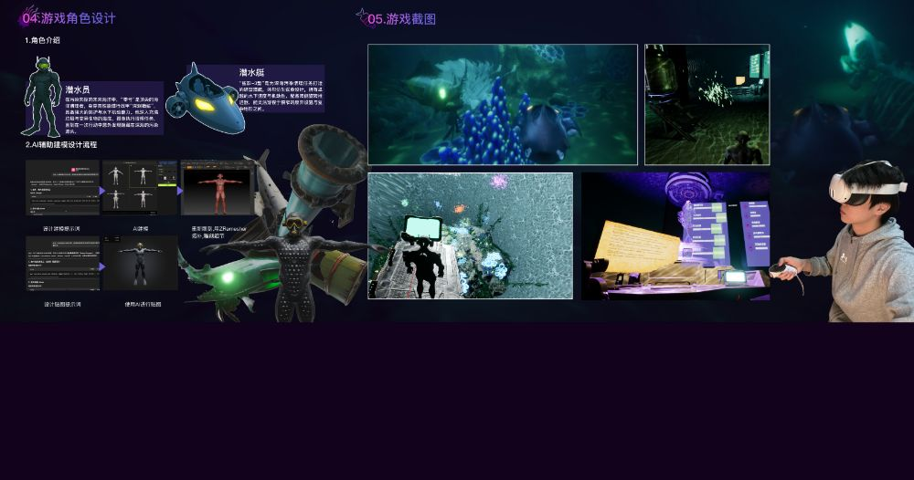
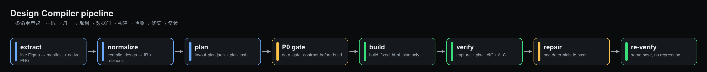
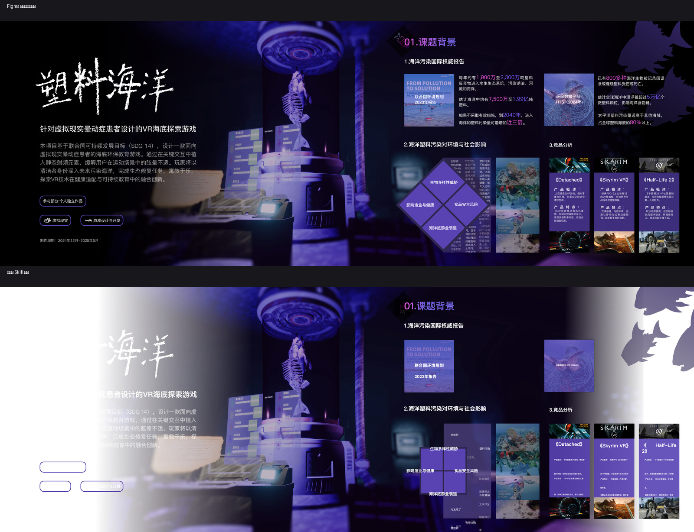
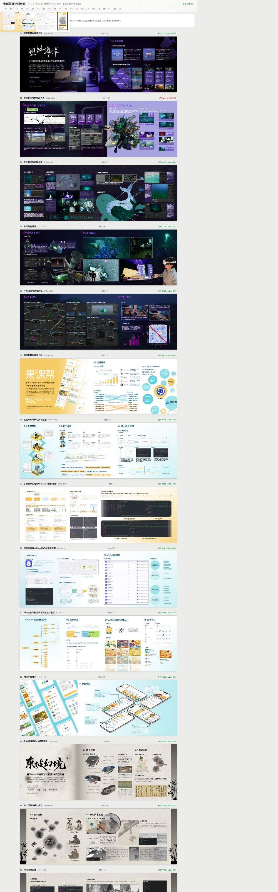
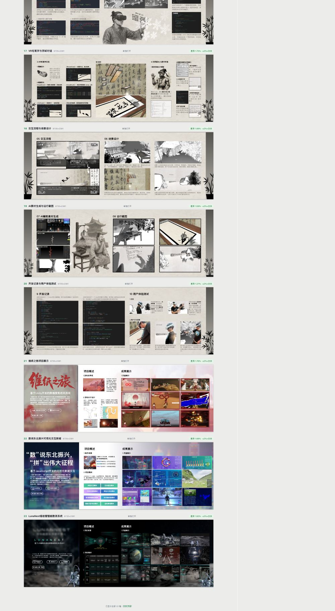

# figma-native-html-reconstruction

**From a 22-artboard portfolio to editable web pages — a personal case study that became a deterministic Design Compiler and an Agent Skill.**

**从 22 个作品集画板到可编辑网页：一个从个人网站真实需求出发，最终沉淀为确定性 Design Compiler 与 Agent Skill 的作品案例。**


> 这不是一次“输入截图、输出一张更像截图的页面”的实验。
>
> 它始于一个更具体的问题：**如何把已经在 Figma 里完成的作品集，变成真正可加载、可编辑、可维护的个人网站页面？**

## 项目概览

| 维度 | 内容 |
|---|---|
| 项目起点 | 个人网站直接插入作品集图片，加载慢，文字也无法选中和编辑 |
| 真实对象 | Figma `html` 页中的 22 个大型作品集画板，包含游戏、VR、APP、信息架构与数据可视化等内容 |
| 核心目标 | 保留原始画板比例与设计关系，同时使用真实 DOM 文字和独立非文字素材 |
| 技术路线 | Figwright / Figma MCP → Design IR → 唯一 layout plan → 固定画板 HTML → 浏览器验收 |
| 最终沉淀 | 可复用 Skill、确定性构建脚本、文本与几何审计、A–G 验收门、回归测试和证据模板 |
| 项目边界 | 不宣称 22 个画板全部通过，不承诺任意 Figma 文件一键达到 1% 或 100% 还原 |

## 01｜起点：把作品集变成网页，而不是把图片搬进网页

这个项目最早不是为了做 Skill。

我当时在制作自己的个人网站，最直接的做法是把作品集画板导出成图片，再插入页面。但图片一大，加载就慢；文字也不能选中、搜索或继续编辑。

于是问题变成了：**能不能把这些作品集画板变成真正的 HTML？**

最早的尝试从“游戏角色设计 + 游戏截图”画板开始：拆出文字和图片，做成语义化、响应式页面。



但这个版本很快暴露了一个目标冲突：响应式重排虽然“像网页”，却改变了作品集原有的构图。随后目标被重新锁定为：**比例固定，与原始画板保持一致。**

整板图片方案也被明确否决。它看似能规避布局问题，实际上回到了最初的痛点——加载、不可编辑、不可维护，什么都没解决。

由此形成四条不能再退让的项目约束：

1. **文字保持真实 DOM**，不能烘焙成图片。
2. **非文字素材独立导出**，不能用整板截图冒充网页。
3. **保留原始画板坐标与比例**，不能在画板内部自由响应式重排。
4. **结果必须能够复核**，不能只用“看起来差不多”作为交付标准。

## 02｜真正的难题：不是生成 HTML，而是保留设计关系

作品集不是一张风格统一的 landing page。22 个画板里有复杂图片合成、混合字体、长段落、信息架构图、流程图、旋转元素和大量箭头连线。

真正反复出现的，是这些具体而琐碎的问题：

- 标题最后一个字被单独挤到下一行；正文溢出或两块文字重叠。
- Figma 中已经隐藏的内容被重新渲染，应该显示的文字却没有出现。
- 元素各自的绝对坐标看似接近，但组件之间的内边距、对齐和相对位置不对。
- GROUP、INSTANCE、旋转与祖先裁剪使用了不同几何口径，测量结果互相矛盾。
- 箭头只连到目标外框，尖端没有真正接到边；总览缩放后连线甚至消失。

这些问题让项目从“让 Agent 写页面”变成了一项更明确的工程任务：**把设计稿当作有坐标、有层级、有文字 runs、有组件关系的系统，而不是一张等待临摹的图片。**

## 03｜路线转折：不让 Agent 排版，让设计数据决定排版

项目最关键的设计决策，是把“生成页面”改成“编译设计”。



整条管线由 `reconstruct.py` 串起：

```text
extract → normalize → analyze → plan → P0 data gate
        → build → verify → one deterministic repair → re-verify
```

其中有两条硬规则。

### 唯一布局计划

`compile_design.py` 将 Figma 导出数据归一化为 design IR、组件关系和确定性的 `layout-plan.json`，同时生成 `planHash`。

`build_fixed_html.py` 只消费这份 plan。Agent 不再根据 reference PNG 猜坐标，也不针对某个节点随手写补偿偏移。参考图只用于最终验收，不参与自由排版。

### 数据不完整，就不构建

P0 数据门在生成 HTML 前检查画板背景、逐 run 字号、渲染盒、素材落点、导出尺寸与几何口径。缺失或含义不明的数据会被阻断，而不是用 16px、黑色、透明背景等默认值悄悄补齐。

这使“看起来像”让位于一个更可复核的原则：**先证明输入是对的，再讨论输出像不像。**

## 04｜三轮攻坚：把返修经验变成通用能力

### 文字：从“调整 CSS”到“编译行计划”

文字是作品集中最密集、也最容易暴露问题的部分。

后期方案不再只比较外层文本框，而是保留逐 run 的字体、字号、字重、样式和颜色；遇到需要校准的换行，通过独立 Figma 校准节点与原生 PDF spans 获取真实行文本和基线，生成行计划。

浏览器端再逐个 TEXT Node 建立 Range，读取真实行盒，检查新增折行、重叠、溢出、字体加载和行计划一致性。固定文本盒的纵向溢出单独记录，不用缩小字号消灭问题。

### 几何与可见性：从“挪元素”到“统一坐标口径”

布局审计逐步区分 `designBox`、`renderAABB`、`pngPlacement`、`exportSize` 和 `effectiveClipRect`，并处理 GROUP 子节点坐标、INSTANCE 导出边界、累积仿射矩阵与祖先有效裁剪。

验收也不只看每个元素自己的绝对位置，还检查父子 inset、同级间距、对齐轴、基线和连接器接边。隐藏节点、透明节点与设计性遮挡分别处理，不能简单按 `visible=true/false` 一刀切。

### 非文字素材与连接器：保留合成效果，但不烘焙整板

不含 TEXT 的最大子树优先原生导出，复杂光影和合成效果因此得以保留；文字仍独立存在于 DOM。

连接器则拆成独立小节点 SVG，使用路径真实端点判断箭头尖端，而不是拿 PNG 外框冒充已经接边。所有连线都与画板内容处于同一个 stage，避免总览缩放后失联。



*一张真实的返修对照：它的价值不是展示“最终已经完美”，而是记录问题如何被定位、修复和重新验证。*

## 05｜验收不是打分，而是保留不通过的权力

项目最后形成了 P0 + A–G 的机读验收门：

| 门 | 关注什么 |
|---|---|
| P0 / A | 输入数据契约、基准图、viewport、DPR 与版本是否冻结 |
| B | 应显示内容是否缺失，隐藏或透明内容是否被多渲染 |
| C | 父子、同级、基线、对齐和接边等相对关系是否成立 |
| D | 真实文字行盒、逐 run 样式、换行、字体、颜色与溢出 |
| E | 独立连接器与 SVG 真尖端是否可验证 |
| F | 原尺寸页面和总览缩放后的实际可见性 |
| G | 同尺寸、同 DPR、同 reference 下的像素回归 |

每道门都有 `pass`、`fail`、`unknown` 三种状态。**没有采集证据就是 `unknown`，绝不自动算通过。**

严格模式默认开启。任一局部缺陷都不能被一张好看的全局平均值掩盖；自动修复也只有一次确定性机会，修不好就如实报告，而不是无限扫参。

## 06｜最终沉淀：不是一组页面，而是一套可复用工作流

这个仓库最终保留的，不只是某次生成的 HTML，而是整个方法可以被再次执行的组成部分：

- `SKILL.md`：任务边界、默认管线、验收和交付合同。
- `scripts/`：导出、编译、数据门、构建、文本与连接器审计、像素复验。
- `references/`：几何、字体、连接器、验证和返修 SOP。
- `tests/`：构建器、编译器和各质量门的回归测试。
- `evidence/` 输出约定：让每个结论都有机器可读证据，让失败可以回退。

<details>
<summary><strong>查看作品集画板的连续检查记录</strong></summary>

这些图片用于说明真实案例的覆盖范围与返修对象，不代表 22 个画板均已通过完整 A–G 严格验收。





</details>

## 07｜项目边界：案例不是成功率承诺

这个项目没有闭合所有目标，也不把一次样本结果外推成通用能力：

- 22 个作品集画板经历了持续转换与返修，但不能写成“22 个画板全部通过”。
- 最近一次全量较严口径下，只有少数画板达到 `outside-text mismatch ≤ 1%`。
- 字体、位图内容、抗锯齿、旋转容器复杂裁剪和 live/reference 版本冲突，仍会形成还原下限。
- 当前路线面向**固定画板高保真重建**，不是自动生成语义化响应式网站的通用方案。
- 原始 Figwright 安装与原始 Figma 设计稿没有被替换或修改；校准实验使用隔离副本或独立校准文件。

<details>
<summary><strong>附录：另一个固定样本 Layout-1 的验证快照</strong></summary>

这组数据只对应仓库内的 Layout-1 固定样本及其冻结环境：同浏览器、同 viewport、同 reference、DPR 1、mismatch threshold 20/255。它不是上述作品集案例的整体成功率，也不代表当前任意输入都能复现。

| Metric | Early build | Recorded result |
|---|---:|---:|
| raw mismatch | 61.04% | **1.875%** |
| outside-text mismatch | 56.53% | **0.0025%** |
| text-region mismatch | 61.77% | **2.22%** |
| SSIM | 0.7962 | **0.9727** |
| MAE per channel | 32.63 | **1.66** |

同一份证据也保留了未闭合项：旋转文字盒仍产生 1 条 fail 与 5 条 `unknown` 关系边，旋转竖排文字保留两条契约级 overflow；没有总览页时 F 门为 `unknown`。

</details>

## 08｜复盘：这个项目真正解决了什么

回头看，最重要的不是把某个百分比压低，而是完成了三次转变：

1. **从图片思维到节点思维**：网页由真实文字、独立素材和设计关系组成。
2. **从 Agent 自由发挥到确定性编译**：布局由数据计划决定，修改可以复现和回退。
3. **从一次性返修到可复用 Skill**：把文字、几何、连接器和验收中踩过的坑，冻结成下一次可以直接执行的流程。

这也是 Skill 最终出现的时机：**先把工作流真正跑通，再把工作流做成 Skill，而不是反过来。**

## Quick start｜从案例到复用

运行环境需要 Figma、Figwright / Figma MCP、Python 3，以及用于浏览器审计的 Playwright + Chromium。Figwright 的官方安装与插件连接方式见 [Figwright README](https://github.com/awdr74100/figwright)。

```bash
git clone https://github.com/BANANACAT26/figma-native-html-reconstruction.git
cd figma-native-html-reconstruction

python3 -m pip install pillow numpy scipy playwright fonttools
python3 -m playwright install chromium

export FIGWRIGHT_SERVER='node /path/to/@figwright/mcp/dist/index.mjs'
export FIGWRIGHT_SESSION_ID='<figma-file-session>'
export FIGWRIGHT_SKIP_TOOLS_LIST=1  # optional

python3 scripts/reconstruct.py \
  --node-id '<artboard-node-id>' \
  --reference reference.png \
  --workdir run-01
```

先阅读 [`SKILL.md`](SKILL.md) 了解交付合同，再按任务需要进入 `references/`。建议先跑通一个画板，确认字体、素材和验收环境，再扩大范围。

## Repository layout

```text
SKILL.md                     operating contract, default pipeline, A–G gates
references/
  sop.md                     production SOP
  case-study.md              method provenance and limitations
  geometry-and-connectors.md coordinate systems, transforms and clipping
  verification.md            evidence and regression rules
  font-sourcing.md           font acquisition and verification
scripts/
  reconstruct.py             one-command strict pipeline
  export_artboard.py         native export and geometry collection
  compile_design.py          manifest → IR → relations → layout plan
  data_gate.py               pre-build contract gate
  build_fixed_html.py        plan-only HTML builder
  audit_*.py / repair_*.py   content, text, relations and connector gates
  verify.py / pixel_diff.py  capture, metrics and evidence hashes
tests/                       regression suites
docs/                        case images and README assets
```

## License & credits

Code and Skill text: MIT. Sample fonts are not redistributed; see [`references/font-sourcing.md`](references/font-sourcing.md).

原始 Figwright 项目与插件遵循其各自许可。作品集中的设计内容用于本项目方法验证与案例记录。
