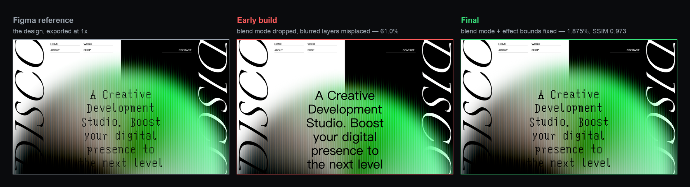
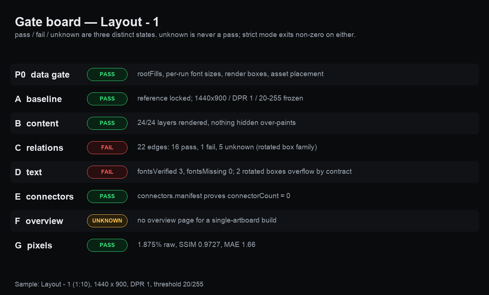

# figma-native-html-reconstruction

**A Skill that turns Figma artboards into genuinely editable HTML — real DOM text, independent assets, fixed canvas coordinates, and a verification loop that refuses to call anything "close enough".**

**一个把 Figma 画板重建为可编辑 HTML 的 Skill：真实 DOM 文字、独立非文字素材、固定画板坐标，并配一套不肯用"看着差不多"蒙混过关的验收闭环。**


## What it does / 它做什么

Point it at an artboard; get back a page you can actually maintain — text you can select and grep, layers you can inspect, numbers you can verify.

把 Skill 指向一个画板，得到的是一份真正能维护的页面：文字能选中、能搜索，图层能审，数字能被复核。

|  | Typical "design to code" output / 常见产出 | What this Skill delivers / 本 Skill 的产出 |
|---|---|---|
| Text | baked into the background image | real DOM nodes, per-run styles preserved |
| Assets | one full-artboard screenshot | one native export per TEXT-free subtree |
| Layout | responsive re-flow that "roughly matches" | fixed 1440×900 stage, absolute canvas coordinates |
| Effects | eyeballed | blend modes, blurs, fills carried from design data |
| Connectors | dropped or approximated | independent node SVGs, arrow tip measured |
| Verdict | "looks close" | machine-readable A–G gates with three states |

## Three fixes, same code / 同一个页面，三次修因



Left: the Figma export. Middle: an early build — the page rendered, but the composition was wrong. Right: the same pipeline after fixing root causes instead of nudging pixels. Each step was driven by a measured signal, not by staring at the screenshot.

左图 Figma 导出；中间是"能渲染但不对"的早期版本；右图是只修根因、不动像素之后的同一套管线产出。每一步都由可测量的信号驱动，不是对着截图挪元素。

## How it works / 工作方式


One command runs the whole chain. Two design choices make the output trustworthy:

- **The plan is the only source of layout.** `compile_design.py` turns the raw Figma export into a deterministic `layout-plan.json` (with a content hash); the HTML builder consumes nothing else. No agent ever places an element by looking at a screenshot.
- **Nothing builds on missing data.** Before any HTML is written, a data gate checks the contract: root fills, per-run font sizes, render boxes, asset placement, effect-expanded bounds. Missing or ambiguous data blocks the build instead of being silently defaulted.

一条命令跑完整条链。两个设计决定让结果可信：**plan 是唯一排版依据**（Agent 从不对着截图摆放元素）；**数据不全就不构建**（生成 HTML 之前先过数据门，缺失或含糊一律阻断，而不是悄悄用默认值填）。

Under the hood the builder only emits `.layer` elements absolutely positioned inside a fixed `#stage`, carries each node's accumulated affine matrix, propagates effective clipping from ancestors, and preserves visible blend modes — which is what keeps composed effects looking like the design instead of like a flat export.

底层上，构建器只输出固定 `#stage` 内绝对定位的 `.layer`，透传每个节点的累积仿射矩阵、沿祖先链传播有效裁剪、保留可见的混合模式——这是合成效果看起来仍是"设计"而不是"一张扁平导出"的原因。

## Verification / 验收



Every stage writes a machine-readable report into `evidence/`. A gate is `pass`, `fail`, or `unknown` — and **`unknown` is never a pass**. If evidence wasn't collected, that is a finding of its own. Strict mode is the default: any `fail` or `unknown` exits non-zero and names the stage.

每道门都把机读报告写进 `evidence/`；`unknown` 表示证据没采到，绝不等于通过。默认 strict：任一 `fail` / `unknown` 都非零退出并点名门。

The gates cover content presence and coverage (B), relative geometry across every neighbour pair (C), real text line boxes and wrapping (D), arrow tips of connectors (E), canonical and overview visuals (F), and same-viewport pixel regression (G) — plus a data-contract gate before build (P0). The point is not the score, it's that any single local defect stays visible instead of being averaged away by a good global number.

门覆盖内容可见性与覆盖（B）、全部相邻关系（C）、真实文字行盒与折行（D）、连接器箭头尖端（E）、canonical 与总览可见性（F）、同视口像素回归（G），以及构建前的数据契约门（P0）。重点不是分数，而是**任何一个局部缺陷都不会被好看的全局数字抹平**。

## Contracts / 硬约束

1. **Text stays text.** Nothing is baked into an image, ever.
2. **Assets stay separate.** Native exports per TEXT-free subtree; never the whole artboard as the page.
3. **The canvas stays fixed.** No responsive re-flow inside the artboard; scaling is display-only.
4. **Never guess a color.** Unresolved image fills, unsupported fills and no-fill text are disclosed, not painted black or white.
5. **Never fake a metric.** No shrinking type to kill overflow, no hiding layers, no rescaling the screenshot to match.
6. **Missing fonts get resolved, not substituted.** The Skill ships a sourcing procedure and a self-check script (`references/font-sourcing.md`, `scripts/check_fonts.py`) so a real font is downloaded, verified and proven loaded — a `@font-face` stub is not a delivery.
7. **One deterministic repair pass.** Text and connector failures get exactly one automatic fix attempt; if it still fails, it reports failure instead of scanning parameters in a loop.

## Results from the included case / 附带案例的实测结果

Same browser, same viewport, same reference, DPR 1, mismatch threshold 20/255.

| Metric | Early build | Final |
|---|---|---|
| raw mismatch | 61.04% | **1.875%** |
| outside-text mismatch | 56.53% | **0.0025%** |
| text-region mismatch | 61.77% | **2.22%** |
| SSIM | 0.7962 | **0.9727** |
| MAE per channel | 32.63 | **1.66** |

Not claimed: rotated text boxes still produce one failing and five `unknown` relation edges, rotated vertical text keeps two contract-level overflows, and the overview gate stays `unknown` when there is no overview page. All three are printed in the delivery.

未声称的部分同样写进交付：旋转文字盒仍会产生 1 条 fail + 5 条 unknown 的关系边，旋转竖排文字保留两条契约级 overflow，没有总览页时 F 门保持 `unknown`。

## Quick start / 快速开始

```bash
git clone https://github.com/BANANACAT26/figma-native-html-reconstruction.git

pip install pillow numpy scipy playwright fonttools
playwright install chromium

export FIGWRIGHT_SERVER='node /path/to/@figwright/mcp/dist/index.mjs'
export FIGWRIGHT_SESSION_ID='<figma-file-session>'
export FIGWRIGHT_SKIP_TOOLS_LIST=1        # optional: skip capability discovery

python3 scripts/reconstruct.py \
  --node-id '<artboard-node-id>' --reference reference.png --workdir run-01
```

The Skill is plain Markdown plus Python — start with [`SKILL.md`](SKILL.md) for the operating contract, then dip into `references/` as the task needs.

Skill 本体是 Markdown 加 Python：先读 [`SKILL.md`](SKILL.md) 掌握交付边界，再按需进 `references/`。

## Repository layout / 目录结构

```text
SKILL.md                     operating contract, default pipeline, A–G gates, delivery rules
references/
  sop.md                     the full production SOP behind the gates
  figwright-mcp.md           MCP/Figwright conventions (serial sessions, degraded discovery)
  geometry-and-connectors.md rotation, GROUP/INSTANCE anchoring, clipping
  connectors.md              connector verdicts: SVG true tip vs PNG bbox
  verification.md            how to verify without fooling yourself
  qa.md                      "metric improved but looks wrong" triage
  font-sourcing.md           tracing, verifying and landing a missing font
  case-study.md              provenance and limits of the method
scripts/
  reconstruct.py             one-command pipeline (strict by default)
  export_artboard.py         native export, affine accumulation, effect-bounds anchoring
  compile_design.py          manifest → IR → relations → layout-plan.json (+ planHash)
  data_gate.py               P0 contract gate, blocks the build
  build_fixed_html.py        plan → fixed-canvas HTML (blend modes, isolation, @font-face)
  check_fonts.py             font landing self-check (name table, weight, cmap, src resolution)
  verify.py / capture.py / pixel_diff.py       capture, metrics, overlay, hashes
  audit_*.py / repair_*.py   gates B–E and their one deterministic repair pass
tests/                       regression suites (builder, gates, compiler)
evals/                       fixtures for the scripts
docs/                        README images + make_images.py (regenerates them from real renders)
```

## Limits / 边界

- AUTO line-height without a calibration sidecar stays `line-height: normal`, and says so.
- Baked bitmap content, color management and antialiasing set a floor no DOM rebuild can remove.
- The method makes a rebuild locatable, auditable and reversible. It does not promise any Figma file lands under 1% mismatch.

## License & credits / 许可与致谢

Code and Skill text: MIT. Fonts used in the sample artboard are not shipped here — the licensing note lives in [`references/font-sourcing.md`](references/font-sourcing.md).

代码与 Skill 文本采用 MIT；示例画板用到的字体不随仓库分发，授权口径见 [`references/font-sourcing.md`](references/font-sourcing.md)。
