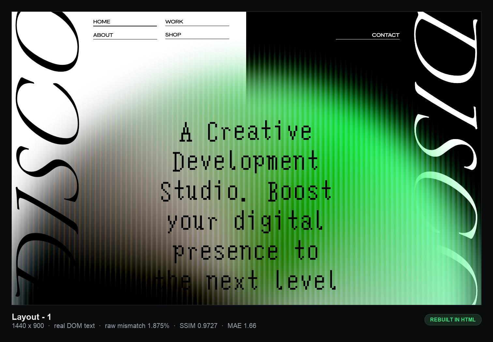
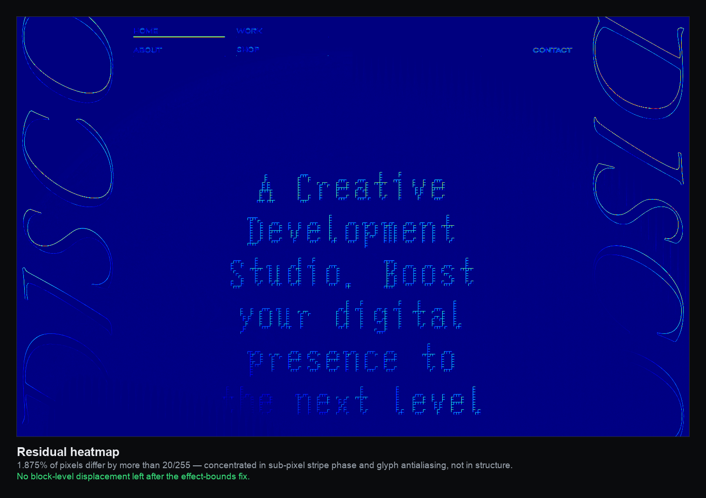

# figma-native-html-reconstruction

**A Skill that rebuilds Figma artboards as genuinely editable HTML — real DOM text, independent assets, fixed canvas coordinates, and a verification loop that refuses to call anything "close enough".**

**把 Figma 画板高保真重建为可编辑 HTML —— 真实 DOM 文字、独立非文字素材、固定画板坐标，配一套不肯用"看着差不多"蒙混过关的验收闭环。**




---

## Why this exists / 为什么做这个

Design-to-HTML tools usually give you one of two things: a picture of a page, or a page that only resembles the design at some other viewport. This Skill takes the third route — treat the artboard as **a coordinate system with layers, z-order and relationships**, then rebuild it as a fixed-size stage where every text node is a real, selectable, auditable DOM node.

设计稿转网页的工具通常只给两种结果：一张页面截图，或者一个"只在某个视口下看着像"的页面。这个 Skill 走第三条路——把画板当成**带图层、层级和关系的坐标系**，重建成固定尺寸的 stage，其中每个文字节点都是真实、可选中、可审计的 DOM。

|  | Naive approach / 常见做法 | This Skill / 本 Skill |
|---|---|---|
| Text | baked into the background image | real DOM text, per-run styles preserved |
| Assets | one full-artboard screenshot | independent native exports, one per TEXT-free subtree |
| Layout | responsive re-flow, "close enough" | fixed 1440×900 stage, absolute canvas coordinates |
| Color | eyeballed | blend modes, fills, effects carried from the design data |
| Fonts | falls back to a system font silently | **missing fonts get downloaded, verified and landed** |
| Verdict | "looks right" | A–G machine-readable gates, `fail` / `unknown` ≠ `pass` |

## Before / after / 修前修后


Left is the Figma export. Middle is the first build that actually rendered — the blend mode was dropped and two 124 px-blurred effects were placed by the wrong box, so the title fell back to a system font and the green gradient sat 124 px too low. Right is the same pipeline after three root-cause fixes.

左图是 Figma 导出；中间是"能渲染但不正确"的第一版——混合模式丢失、两个带 124px 模糊的图层按错误盒放置，标题回退成系统字体、绿渐变整体下移 124px；右图是修完三处根因之后的同一套管线。

## The pipeline / 管线


`extract → normalize → plan → P0 data gate → build → verify → repair → re-verify`, all behind one command. Two rules make it trustworthy:

- **The plan is the only source of layout.** `compile_design.py` turns the raw Figma export into `layout-plan.json` (with a `planHash`), and the HTML builder consumes nothing else. No agent ever nudges elements by looking at a screenshot.
- **Nothing is built on missing data.** A P0 gate checks the manifest → IR → plan contract before a single line of HTML exists: root fills, per-run font sizes, render boxes, asset placement, effect-expanded bounds. It blocks the build instead of guessing.

一条命令串起整条管线。两条原则让它可信：**plan 是唯一的排版依据**（Agent 从不对着截图挪元素）；**数据不全就不构建**（P0 数据门在生成 HTML 之前检查契约，宁可阻断也不猜）。

## Gates: pass, fail, unknown / 三门状态


Every stage writes a machine-readable report into `evidence/`. A gate is `pass`, `fail`, or `unknown`, and **`unknown` is never a pass** — if the evidence wasn't collected, that is its own finding. Strict mode is the default: any `fail` or `unknown` exits non-zero and names the stage.

每道门都把机读报告写进 `evidence/`；`unknown` 表示"证据没采到"，绝不等于通过。默认 strict：任一 `fail` / `unknown` 都非零退出并点名。

## The part people always get wrong: fonts / 最容易被糊弄过去的一环

Missing fonts are **not** a disclosure item — they are a TODO. This Skill ships a font-sourcing procedure and a self-check script, because "I left an `@font-face` mount point, please supply the file yourself" is not a delivery.

- The requirement comes from **per-run** `fontName` (`fontName: 'mixed'` must be expanded — one line can use two families).
- Scan the machine by name table (`nameID` 1 / 2 / 4 / 6), never by filename.
- Search the web by exact **PostScript / filename** (`FZXS15--GB1-0.ttf`, `HKGroteskWide-Regular.otf`), then download from the site's **file link**, not its "download client" button.
- Verify **before** landing: MD5 against the published value, name table, weight, `cmap` coverage.
- Prove it loaded: `document.fonts.check()` plus `fontsVerified` / `fontsMissing` in the audit report — not just a `font-family` string.

缺字体是待办，不是可交付的结论。流程与自检脚本都随仓库提供：从 **per-run** 的 `fontName` 取真实需求（`mixed` 必须展开）、按 name 表扫本机、按确切文件名联网找、按 MD5 与 name 表校验后再落地、最后用 `document.fonts.check()` 证明它真的加载了。

```bash
python3 scripts/check_fonts.py \
  --fonts-dir fonts --css fonts/fonts.css --html page.html \
  --plan export/layout-plan.json --text-manifest export/text-manifest.json \
  --glyphs "ABCabc0123"
# exit 0 → every family+style is landed; exit 1 → go download it
```

Two silent failure modes are documented in the reference, because both were hit for real: a reuse path that skipped the build step (so the "re-verified" page was the old one, `@font-face` count 0), and a stale `layout-plan.json` that skipped recompilation (so an export fix never reached the plan).

文档里还记了两个真实踩过的坑：复用导出目录时跳过 build，导致"复验"的是旧页面；以及 `layout-plan.json` 没删，导致改过的导出数据根本没进 plan。

## Metrics from the included case / 附带的真实案例指标

Same browser, same viewport, same reference, DPR 1, mismatch threshold 20/255.

| Metric | First working build | Final |
|---|---|---|
| raw mismatch | 61.04% | **1.875%** |
| outside-text mismatch | 56.53% | **0.0025%** |
| text-region mismatch | 61.77% | **2.22%** |
| SSIM | 0.7962 | **0.9727** |
| MAE per channel | 32.63 | **1.66** |



What is left is sub-pixel stripe phase and glyph antialiasing — no block-level displacement, no missing content, no wrong colors. What is **not** claimed: the C gate still reports one `fail` and five `unknown` on rotated text boxes, the D gate keeps two rotated vertical boxes overflowing by contract, and F stays `unknown` because a single-artboard build has no overview page. All three are printed in the delivery instead of being averaged away.

剩下的残差只是细条纹的亚像素相位与字形抗锯齿，没有整块错位、没有内容缺失。**没有**声称的部分同样写进交付：C 门在旋转文字盒上仍报 1 条 fail + 5 条 unknown，D 门保留两条旋转竖排盒的口径 overflow，F 门因为没有总览页而保持 `unknown`——不取平均蒙过去。

## Quick start / 快速开始

```bash
# 1. install into your agent's skills root
git clone https://github.com/xjjm123123123/figma-native-html-reconstruction.git

# 2. dependencies
pip install pillow numpy scipy playwright fonttools
playwright install chromium

# 3. point the client at your Figwright / Figma MCP server
export FIGWRIGHT_SERVER='node /path/to/@figwright/mcp/dist/index.mjs'
export FIGWRIGHT_SESSION_ID='<figma-file-session>'
export FIGWRIGHT_SKIP_TOOLS_LIST=1        # optional: skip capability discovery

# 4. one command, live Figma → verified HTML
python3 scripts/reconstruct.py \
  --node-id '<artboard-node-id>' --reference reference.png --workdir run-01
```

The Skill itself is plain Markdown + Python: read [`SKILL.md`](SKILL.md) for the operating contract, then `references/` for the SOP, the Figwright conventions, geometry/connectors and the font-sourcing playbook.

Skill 本体就是 Markdown + Python：先读 [`SKILL.md`](SKILL.md) 掌握交付边界，再按需进 `references/` 查 SOP、Figwright 约定、几何与连接器、以及字体获取手册。

## Repository layout / 目录结构

```text
SKILL.md                     operating contract, default pipeline, A–G gates, delivery rules
references/
  sop.md                     the full production SOP behind the gates
  figwright-mcp.md           MCP/Figwright conventions (serial sessions, degraded discovery)
  geometry-and-connectors.md rotation, GROUP/INSTANCE anchoring, clipping
  connectors.md              connector verdicts: SVG true tip vs PNG bbox
  verification.md            how to verify without fooling yourself
  qa.md                      "metric improved but looks wrong" triage
  font-sourcing.md           where fonts come from, what to reject, how to prove they loaded
  case-study.md              provenance and limits of the method
scripts/
  reconstruct.py             one-command pipeline (strict by default)
  export_artboard.py         native export, affine accumulation, effect-bounds anchoring
  compile_design.py          manifest → IR → relations → layout-plan.json (+ planHash)
  data_gate.py               P0 contract gate, blocks the build
  build_fixed_html.py        plan → fixed-canvas HTML (blend modes, isolation, @font-face)
  check_fonts.py             font landing self-check (name table, weight, cmap, src resolution)
  verify.py / capture.py / pixel_diff.py       capture, metrics, heatmap, hashes
  audit_*.py / repair_*.py   gates B–E and their one deterministic repair pass
tests/                       regression suites (builder, gates, compiler)
evals/                       fixtures for the scripts
docs/                        README images + make_images.py (generates them from real renders)
```

## Design contracts / 硬约束

1. **Text stays text.** No text is baked into an image, ever.
2. **Assets stay separate.** One native export per TEXT-free subtree; never the whole artboard.
3. **The canvas stays fixed.** No responsive re-flow inside the artboard.
4. **Never guess a color.** Missing image fills, unsupported fills and no-fill text are disclosed, not painted black.
5. **Never fake a metric.** No shrinking font-size to kill overflow, no hiding layers, no scaling the screenshot to match.
6. **Download before disclosing.** A missing font is a task, not an excuse.

## Known limits / 已知边界

- AUTO line-height without a calibration sidecar stays `line-height: normal` (unresolved, and reported as such).
- Rotated vs unrotated box families produce `unknown` relation edges; that is a measurement-family gap, not a layout bug — and it stays visible in the report.
- The method makes a rebuild locatable, auditable and reversible. It does **not** promise any Figma file lands under 1% mismatch: baked bitmap content, color management, antialiasing and live/reference version drift all set a floor.

## License & credits / 许可与致谢

Code and Skill text: MIT. The fonts used in the sample artboard are **not** shipped here — 方正像素15 is free for non-commercial use only (commercial use requires a license from Founder Type), and HK Grotesk is OFL. Font files stay with their owners; this repo only documents how to obtain and verify them.

代码与 Skill 文本采用 MIT。示例画板用到的字体**不随仓库分发**——方正像素15 仅限非商业使用（商用需向方正取得授权），HK Grotesk 为 OFL 授权。字体文件归各权利人所有，本仓库只记录如何获取与校验。

---

*If this saved you a week of "why is the text wrong", a star is cheap. / 如果它帮你省了几天"文字为什么不对"的排查，点个 star 不花钱。*
